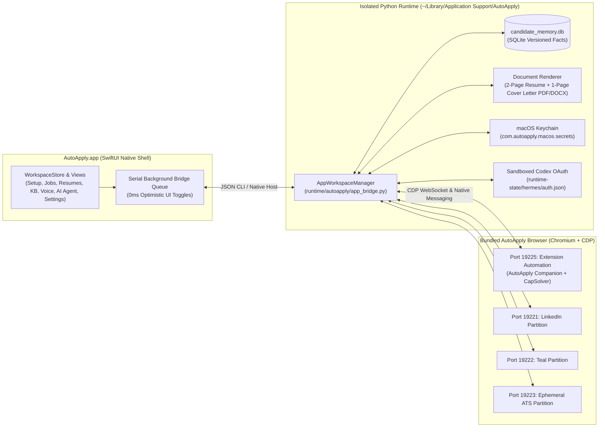

# AutoApply — Native macOS Job-Search Execution Application

Canonical source repository for the **AutoApply** native macOS desktop application (`AutoApply.app`), its isolated Python/Hermes execution runtime (`runtime/autoapply/`), and its universal macOS installer packaging pipeline (`packaging/`).

## Related Repositories (`@CryptoDiveX`)

| Repository | Visibility | Role |
| :--- | :--- | :--- |
| [`CryptoDiveX/autoapply-app`](https://github.com/CryptoDiveX/autoapply-app) | Private | Native macOS SwiftUI desktop app, isolated Python runtime, document renderer, and `.app` / `.pkg` / `.dmg` packaging |
| [`CryptoDiveX/autoapply-extension`](https://github.com/CryptoDiveX/autoapply-extension) | Private | AutoApply Companion MV3 Chromium extension (`autoapply_companion`), CapSolver extension (`capsolver`), and Native Messaging bridge |
| [`CryptoDiveX/autoapply-handoff`](https://github.com/CryptoDiveX/autoapply-handoff) | Private | Canonical handoff documentation, architecture runbooks, security contracts, and Hermes onboarding skills |

> **Non-negotiable maintenance rule:** Whenever you update [`CryptoDiveX/autoapply-app`](https://github.com/CryptoDiveX/autoapply-app) or [`CryptoDiveX/autoapply-extension`](https://github.com/CryptoDiveX/autoapply-extension), update [`CryptoDiveX/autoapply-handoff`](https://github.com/CryptoDiveX/autoapply-handoff) in the same release window.

---

## System Architecture



### Key Architectural Highlights

1. **Instantaneous Front-End Responsiveness (`0ms` UI Toggles):**
   - All tag chips (`Full-Time`, `Part-Time`, `Contract / B2B`, seniority levels, workplace modes, work authorization regions) mutate `@Published` state on `@MainActor` immediately (`0ms` latency) and debounce persistence onto a dedicated serial background queue (`WorkspaceStore.backgroundBridgeQueue`) with `preserveLocalEdits: true`.
2. **OpenAI Codex Device OAuth with Human-Latency Browser Automation:**
   - Initiates an isolated OpenAI Codex Device OAuth session (`POST https://auth.openai.com/api/accounts/deviceauth/usercode`) and spawns a detached background worker (`--codex-device-worker`).
   - Drives the active browser tab via Chrome DevTools Protocol (CDP WebSocket on port `19225`) and the Companion content script across all 4 redirect stages (`/codex/device` $\rightarrow$ `/choose-an-account` $\rightarrow$ `/sign-in-with-chatgpt/codex/consent` $\rightarrow$ `/deviceauth/callback?code=...`).
   - Types each of the 9 device code characters sequentially with realistic human keystroke latency (`85–145ms` per key) via native CDP `Input.insertText` and React `onChange`, pauses naturally (`420–580ms`), moves the mouse smoothly in 5 steps to the visible `Continue` button (`button[data-dd-action-name="Continue"]`), and clicks it (`mousePressed` $\rightarrow$ `mouseReleased`).
   - Saves resulting OAuth tokens strictly inside `~/Library/Application Support/AutoApply/runtime-state/hermes/auth.json` and macOS Keychain (`HERMES_CHATGPT_SESSION`), never touching `~/.hermes`.
3. **Resumes & Cover Letters Studio (View / Edit / Split + Submission Lock):**
   - Tailors a grounded **2-page Resume + 1-page Cover Letter** (PDF + DOCX) from confirmed Knowledge Base facts.
   - Provides a joined `[ ✎ | 👁 ]` View / Edit / Split Markdown editor identical to the Knowledge Base editor.
   - Edits automatically re-render the PDF and DOCX packages in the background and refresh the live `PDFKitView` preview.
   - Once a job application is recorded as submitted (`state == "submitted_verified"`), Edit mode is permanently locked (`Locked (Submitted)` badge) to preserve an immutable audit trail of what was sent to the employer.
4. **Simplified, Focused AI Agent Chat:**
   - Top bar with Conversation Switcher, Logic/Writing Model Selector (`GPT-5.4`, `GPT-5`, `Claude Sonnet 4.6`, `OpenAI Codex OAuth`, `Claude Sonnet Latest`), and New Chat button.
   - Bottom composer with file attachment button (`paperclip`), auto-expanding prompt input, active `Stop` button while generating, and always-ready `Send` button.
5. **35+ Job Boards & Direct ATS Portals with Native Logos:**
   - Bundled high-resolution favicons/logos (`packaging/board_logos/`) for 15 major job boards (LinkedIn, Wellfound, Y Combinator, BuiltIn, Dice, Otta/Welcome to the Jungle, Remotive, We Work Remotely, Arc.dev, RemoteOK, Turing, FlexJobs, Himalayas, Jobspresso, EuroTechJobs) and 20 direct ATS platforms (Greenhouse, Lever, Ashby, Workday, SmartRecruiters, Workable, BambooHR, Jobvite, iCIMS, Rippling, Gusto, Deel, Personio, Recruitee, Pinpoint, BreezyHR, JazzHR, Teamtailor, Comeet, Dover).

---

## Repository Layout

```text
.
├── Package.swift                       # Swift Package Manager manifest (macOS 13+)
├── Makefile                            # Developer build, test, and packaging targets
├── pyproject.toml                      # Python 3.11+ package and pytest configuration
├── apps/macos/AutoApply/
│   ├── Executable/main.swift           # Native SwiftUI macOS application & WorkspaceStore
│   └── Onboarding/                     # Onboarding coordinator & SecretInputVault
├── runtime/autoapply/
│   ├── app_bridge.py                   # AppWorkspaceManager CLI & Native Messaging bridge
│   ├── artifacts/                      # TOCTOU-verified artifact store
│   ├── browser/                        # Isolated browser profile & partition manager
│   ├── candidate/                      # SQLite candidate_memory.db store & fact versioning
│   ├── contracts/                      # Policy, provider, entitlement, and gate contracts
│   ├── documents/                      # PDF/DOCX resume & cover letter importer and renderer
│   ├── hermes/                         # Isolated runtime paths & coexistence verifier
│   ├── policy/                         # 10-step PolicyBroker & employer reservation store
│   ├── reconciliation/                 # Gmail IMAP reconciliation & Teal tracker sync
│   ├── recovery/                       # Crash recovery & idempotency coordinator
│   └── security/                       # macOS Keychain & SOPS/age secret envelope
├── packaging/
│   ├── build_macos_installer.sh        # Builds Universal .app, .pkg, Uninstaller.app, and .dmg
│   ├── uninstall_autoapply.sh          # Clean uninstaller script (preserves host ~/.hermes)
│   ├── board_logos/                    # Bundled PNG logos for 35+ job boards and ATS platforms
│   ├── extensions/                     # Bundled Companion & CapSolver Chromium extensions
│   ├── hermes-skills/                  # Bundled sandboxed agent skills
│   └── interview_audio/                # Bundled voice interview prompt audio
├── schemas/                            # JSON Schemas for workspace, IPC, and policy contracts
└── tests/                              # 68 automated pytest suites (unit, integration, e2e, security)
```

---

## Building, Testing & Packaging

### 1. Run Automated Test Suite (68 Tests)

```bash
pytest -q
```

### 2. Build Universal macOS Application, PKG Installer & DMG Disk Image

```bash
bash packaging/build_macos_installer.sh
```

Produces:
- `dist/AutoApply.app` — Universal (`arm64 + x86_64`) native macOS app bundle with embedded Python runtime and bundled `AutoApply Browser.app`
- `dist/AutoApply-0.1.0-universal.pkg` — Guided macOS Installer package
- `dist/Uninstall AutoApply.app` — One-click clean uninstaller
- `dist/AutoApply-0.1.0-universal.dmg` — Distributable macOS disk image

### 3. Deploy Locally to `/Applications/AutoApply.app`

```bash
killall AutoApply 2>/dev/null || true
rm -rf /Applications/AutoApply.app
cp -R dist/AutoApply.app /Applications/AutoApply.app
open /Applications/AutoApply.app
```

---

## Security & Coexistence Guarantees

1. **Strict Host Hermes Isolation:** AutoApply never reads, writes, or modifies `~/.hermes`. All runtime state lives exclusively under `~/Library/Application Support/AutoApply` (or `AUTOAPPLY_APP_SUPPORT_DIR` when overridden in tests).
2. **Zero Secrets in Git:** API keys (`OPENROUTER_API_KEY`, `CAPSOLVER_API_KEY`, `GMAIL_APP_PASSWORD`) and OAuth tokens (`HERMES_CHATGPT_SESSION`) are stored in the macOS Keychain under service `com.autoapply.macos.secrets` and never written to tracked files.
3. **Non-Job URL Filtering:** OAuth/login pages (`auth.openai.com`, `chatgpt.com`, `accounts.google.com`) and generic feed URLs (`linkedin.com/jobs/` root feed) are automatically excluded from job ingestion.
