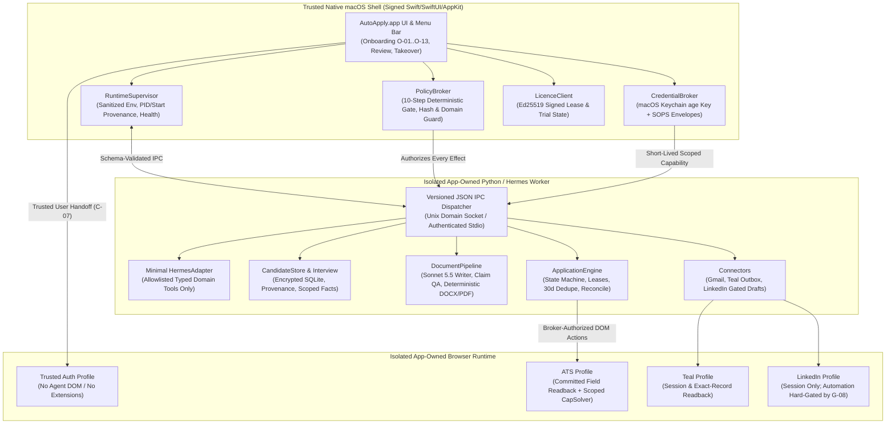

# AutoApply — Architecture, Dated Feasibility Matrix & First Vertical Slice Plan

- **Date:** 2026-10-18
- **Status:** Phase 0 Architecture & Feasibility Baseline (`P00`)
- **Tied Requirements:** `AA-INS-001`..`AA-UX-004`, `NFR-01`..`NFR-09`, `C-01`..`C-12`, `G-01`..`G-09`, `D-01`..`D-18`

---

## 1. System Architecture & Trust Boundaries

### Policy Evaluation Order (Enforced Outside LLM in `native/PolicyBroker`)
Every privileged IPC proposal is evaluated in strict deterministic order:
1. `cancellation` (Run/job emergency stop or user pause)
2. `platform_permissions` (macOS TCC & vendor gate status `G-01`..`G-09`)
3. `installation_account_ownership` (Verified active account matches target binding)
4. `licence_policy` (Valid server-issued 120h trial or active 72h signed paid lease)
5. `user_mandate_approval` (`review_first` approval ID or active bounded auto-submit mandate revision)
6. `truthful_confirmed_facts` (All required fields backed by `confirmed=true` scoped facts; zero unconfirmed legal/demographic guesses)
7. `artifact_approval` (Exact SHA-256 byte match of frozen-original or tailored-approved document at outbound boundary)
8. `domain_recipient_allowlist` (Target URL/domain matches canonical employer ATS; recipient not in hard-bounce register; no localhost/private-IP SSRF)
9. `dedupe_reservation` (Atomic SQLite lease held by single submission owner; no rolling 30-day employer conflict)
10. `spending_rate_limits` (Within per-run and daily token/USD/CapSolver caps)

---

## 2. Dated Feasibility Matrix (As of 18 October 2026)

| Domain & Requirement IDs | Published Permission (`10-SOURCES.md`) | Technically Observed Capability | Proposed Architecture | Unknowns & Required Spikes |
| :--- | :--- | :--- | :--- | :--- |
| **Installation & Isolation** `AA-INS-001`..`005`, `NFR-01`, `C-01`, `C-06` | Upstream Hermes is MIT-licensed (`[2]`). Apple requires Developer ID + Hardened Runtime + notarization for direct macOS distribution (`[22]`). | Hermes supports `HERMES_HOME` profile isolation (`[1]`), but subprocesses and Python site-packages require explicit environment sanitization. | Bundle private Python + reduced Hermes commit inside signed `.app`; write state only to `~/Library/Application Support/AutoApply/`; sanitize child `env` via strict allowlist. | **Spikes `P01`, `P05`, `P07` (`G-09`):** Verify nested binary signing, App Sandbox/XPC helper containment boundaries (`C-06`), and zero-touch coexistence (`T-INS-02`). |
| **Commercial Licensing & Billing** `AA-LIC-001`..`004`, `C-02`, `C-12` | No platform restriction on direct web checkout + licence key activation outside the Mac App Store. | Standard Ed25519 signed leases and Stripe webhook idempotency patterns apply. | Reserve trial on `O-02`; activate server-issued 120h trial only on `O-13` after readiness checks (`C-02`). Paid USD 20/mo key issues 72h signed lease verified offline by embedded public key. | **Decisions `D-10`, `D-11`, `D-18`:** Confirm seat transfer policy, offline clock-tamper revalidation threshold, and merchant setup (`P27`–`P28`). |
| **AI Providers & Orchestration** `AA-AUTH-001`..`002`, `AA-DOC-001`, `NFR-03`, `C-03` | OpenAI SIWC requires commercial client approval for paid apps (`[3][4]`). OpenRouter public catalog (`[11]`) lists `anthropic/claude-sonnet-5.5` (tools + vision) and `cognitivecomputations/dolphin-mistral-24b-venice-edition` (text-only, no native `tools` advertised, no `:free` variant). | Public catalog snapshot verified on `2026-10-18` (`docs/evidence/model-catalog-snapshot.json`). No paid inference executed yet. | Separate `writer` (`anthropic/claude-sonnet-5.5`) and `orchestrator` routes. Gate ChatGPT/Codex behind `G-02`. Build strict JSON-schema DOM text action-proposal adapter for Dolphin (`G-03`). | **Spike `P02` (`G-02`, `G-03`):** Benchmark Dolphin typed-action adapter against ATS fixtures; verify whether Codex remote-session toggle is needed for approved commercial flow. |
| **CloakBrowser & CapSolver** `AA-AUTH-003`..`004`, `C-01`, `C-07` | CloakBrowser binary licence prohibits bundling/OEM/customer browser control without separate agreement (`[12][13][14]`). CapSolver docs show `assets/config.js` key setup (`[15]`). | Free GitHub key allows 1 concurrent session. Plaintext `config.js` violates `AA-AUTH-004`/`C-07`. | Time-multiplex 4 isolated profiles (`auth`, `ats`, `teal`, `linkedin`) within 1 session (`C-07`). Load CapSolver only in `ats` profile with ephemeral runtime key injection. | **Spikes `P01`, `P04`, `P26` (`G-01`, `G-06`):** Obtain CloakBrowser OEM terms; verify isolated cache/licence overrides and ephemeral CapSolver key injection. |
| **Gmail Integration** `AA-MAIL-001`..`005`, `C-04`, `C-05` | Google requires 2SV for App Passwords and blocks them on Advanced Protection/Workspace (`[19]`). Gmail OAuth scopes require production verification & Limited Use compliance when using cloud LLMs (`[20][21]`). | Local thread/header/bounce parsing works deterministically without cloud LLMs. Scraping Google security pages in agent DOM is unsafe (`C-04`). | Recommend Desktop OAuth PKCE primary + eligibility-gated App Password flow using trusted native secret capture. Enforce `PolicyBroker` default-deny on sending Gmail data to cloud LLMs until `G-05` clears (`C-05`). | **Spikes `P03`, `P04` (`G-04`, `G-05`):** Verify native secret capture vs. OAuth PKCE; complete Google verification & processor assessment before enabling cloud LLM mail analysis. |
| **Candidate KB, Voice & Documents** `AA-KB-001`..`005`, `AA-DOC-001`..`005`, `C-09`, `C-11` | Fully local/BYOK candidate processing; microphone requires macOS TCC `NSMicrophoneUsageDescription`. | Deterministic DOCX/PDF rendering, visual page geometry comparison, and SHA-256 action-boundary guards are fully buildable locally. | Encrypted SQLite `CandidateStore` with scoped facts/answers; optional voice interview with transcript review; deterministic reference-style renderer + visual/ATS QA + outbound SHA-256 guard. | **Spikes `P04`, `P10`–`P15`:** Select and test SQLCipher/encrypted SQLite + artifact encryption (`C-09`); define visual layout QA tolerances (`C-11`). |
| **Application Engine & ATS Execution** `AA-JOB-001`..`008`, `AA-UX-001`..`004`, `C-10` | Target ATS platforms require user-authorized submissions and prohibit anti-abuse evasion. | React/controlled inputs require DOM value readback, not click success. Non-interfering background mode works via owned browser session without physical cursor/Space changes. | Single-owner SQLite lease + `Attempt` idempotency key + `submitted_unverified` crash recovery + non-stealing background browser + human takeover lease (`C-10`). | **Spikes `P16`–`P21`:** Build local synthetic ATS fixture server (`P18`); select and authorize 1 live ATS pilot (`P21`). |
| **Teal & LinkedIn Connectors** `AA-TRACK-001`..`002`, `AA-SOC-001`..`002`, `C-08`, `C-10` | Teal terms govern service use; no public write API verified (`[16][17]`). LinkedIn strictly prohibits automated scraping, polling, invitations, and messaging (`[18]`). | Local SQLite ledger + outbox + CSV export and local LinkedIn draft generation/reminders work without platform violations. | Authoritative local ledger + `sync_pending` outbox (`G-07`). Hard-block all automated LinkedIn reads, polls, invitations, and sends in `PolicyBroker` (`G-08`); provide manual user-handoff drafts. | **Spike `P03` (`G-07`, `G-08`) & Decisions `D-05`, `D-06`:** Confirm Teal integration permission and founder acceptance of manual-assist LinkedIn launch scope. |

---

## 3. Exact Model & Provider Role Routing Contract

Per `02-TECHNICAL-SPECIFICATION.md` (§8), `05-INTEGRATIONS-AND-RELEASE-GATES.md` (`F-04`), and `C-03`:

| Role ID | Exact Model / Route Identifier | Credential & Transport | Advertised Capabilities (`2026-10-18` Snapshot) | Policy & Fallback Rules |
| :--- | :--- | :--- | :--- | :--- |
| `orchestrator.primary` | Approved ChatGPT / Codex commercial route (`G-02`) | Customer's own ChatGPT account via approved commercial OAuth/PKCE client (`AA-AUTH-002`). Never reuse founder/dev tokens or route to OpenAI API credits. | Native tool use, structured outputs, browser reasoning (subject to `G-02` verification). | **Disabled until `G-02` is approved.** When missing auth, routes to `orchestrator.fallback` only if `G-03` passes. On expired auth, prompts user reconnect. |
| `orchestrator.fallback` | `cognitivecomputations/dolphin-mistral-24b-venice-edition` | Customer's OpenRouter API key (`AA-AUTH-001`) via `CredentialBroker` over HTTPS. | `context_length: 128000`, `modality: text->text`, `response_format` supported; **no native `tools`/`tool_choice` or image input advertised; no `:free` variant.** | Uses deterministic JSON-schema action-proposal adapter (`P02`). Never silently append `:free` or swap to another paid model. Pauses if a step requires vision or if schema/progress validation fails. |
| `writer.primary` | `anthropic/claude-sonnet-5.5` | Customer's OpenRouter API key (`AA-AUTH-001`) via `CredentialBroker` over HTTPS. | `context_length: 1000000`, `modality: text+image+file->text`, `tools`, `structured_outputs`, `response_format`. | Dedicated to resumes, cover letters, and open-ended screening answers (`AA-DOC-001`). Never silently used as browser orchestrator without explicit owner/user policy approval. |
| `helper.compression_and_qa` | Explicitly mapped to active approved route (`writer.primary` or local deterministic parser) | Uses the exact same user-consented credential route; **never** switches to an unconfigured or separately billed OpenAI API key. | Bounded context summarization and claim-to-fact verification. | Default-deny for Google-derived mail data until `G-05` is cleared (`C-05`). |

---

## 4. Phase 0 Spikes & First Vertical Slice Implementation Plan

### 4.1 Phase 0 Feasibility Spikes (`P00`–`P04`)

| Ticket | Status | Exact Target Files & Schemas | Exact Verification Tests |
| :--- | :--- | :--- | :--- |
| **P00** | **Completed (Local Docs)** | `docs/decisions/0001-scope.md` `docs/release/gates.json` `docs/release/requirements-traceability.csv` `docs/release/original-brief-coverage.csv` `docs/architecture/0001-architecture-and-feasibility-plan.md` `docs/evidence/model-catalog-snapshot.json` | Integrity verification of all 54 requirements, 62 test IDs, 34 brief mappings, and 9 release gates (`G-01`..`G-09`). |
| **P01** | Planned Next | `docs/evidence/browser-licensing.md` `runtime/autoapply/browser/paths.py` `tests/coexistence/test_browser_paths.py` | `uv run pytest tests/coexistence/test_browser_paths.py` — Verify isolated app-owned browser binary, profile (`auth`, `ats`, `teal`, `linkedin`), cache, and licence paths never touch `~/.cloakbrowser` or user browsers (`T-INS-02`, `AA-AUTH-003`). |
| **P02** | Planned Next | `schemas/provider.schema.json` `runtime/autoapply/providers/registry.py` `runtime/autoapply/providers/dolphin_adapter.py` `tests/contract/test_provider_capabilities.py` | `uv run pytest tests/contract/test_provider_capabilities.py` — Verify exact model ID preservation (`anthropic/claude-sonnet-5.5`, `cognitivecomputations/dolphin-mistral-24b-venice-edition`), rejection of `:free` or unapproved model swaps, and deterministic Dolphin typed-action proposal parsing/rejection (`T-MODEL-01`, `T-MODEL-02`). |
| **P03** | Planned Next | `docs/evidence/google.md` `docs/evidence/teal.md` `docs/evidence/linkedin.md` `docs/evidence/macos-permissions.md` `runtime/autoapply/policy/feature_gates.py` `tests/contract/test_feature_gates.py` | `uv run pytest tests/contract/test_feature_gates.py` — Prove closed gates (`G-01`..`G-09`) deterministically block unapproved external operations (including LinkedIn reads/polls/sends per `T-SOC-01` and Google-to-LLM data routing per `C-05`) even when a session or user consent exists. |
| **P04** | Planned Next | `docs/architecture/secrets.md` `schemas/secret_envelope.schema.json` `native/CredentialBroker/CredentialBroker.swift` `runtime/autoapply/security/sops_age.py` `tests/security/test_secret_envelope.py` | `uv run pytest tests/security/test_secret_envelope.py` — Prove per-installation `age` key generation, Keychain custody interface, SOPS+age encryption/decryption, zero adjacent private keys, canary secret redaction in logs, and ephemeral extension key handling (`T-SEC-01`, `T-SEC-02`, `T-SEC-03`). |

### 4.2 First End-to-End Local Vertical Slice (Phase 1 `P05`–`P09` + Core Slice Preview)

Once the owner approves the Phase 0 decisions, we will execute sequential TDD slices starting with **Phase 1 (Isolated Shell, Supervisor, IPC & Policy Broker)**:

1. **Build Foundation & Isolated Python Package (`P05`):**
   - **Files:** `pyproject.toml`, `Makefile`, `packaging/runtime-manifest.json`, `apps/macos/Package.swift` (or `AutoApply.xcodeproj`).
   - **Tests:** `make verify-local` running `pytest` across `tests/unit`, `tests/contract`, `tests/security`, `tests/coexistence`.
2. **Native macOS Shell & Resumable Onboarding State (`P06`):**
   - **Files:** `apps/macos/AutoApply/App/AutoApplyApp.swift`, `apps/macos/AutoApply/MenuBar/MenuBarPopoverView.swift`, `apps/macos/AutoApply/Onboarding/OnboardingCoordinator.swift` (`O-01`..`O-13`, enforcing `O-02` reserve vs. `O-13` activate per `C-02`).
   - **Tests:** `tests/e2e/OnboardingUITests/OnboardingStateTests.swift` (`T-UX-05`, `T-LIC-01`).
3. **Private Runtime Supervisor & Environment Isolation (`P07`):**
   - **Files:** `native/RuntimeSupervisor/Launcher.swift`, `runtime/autoapply/main.py`, `runtime/autoapply/isolation.py`.
   - **Tests:** `tests/coexistence/test_runtime_isolation.py` (`T-INS-02`, `T-INS-03`) — proving allowlisted environment variables, pinned `HERMES_HOME` under app support root, PID + start-time provenance tracking, and zero leakage of parent `PYTHONPATH`, `PATH`, `~/.hermes`, or `~/.codex`.
4. **Versioned JSON IPC Contract (`P08`):**
   - **Files:** `schemas/ipc.schema.json`, `native/IPC/IPCChannel.swift`, `runtime/autoapply/ipc/protocol.py`.
   - **Tests:** `tests/contract/test_ipc.py` (`T-SEC-04`, `T-UX-03`) — validating protocol v1 envelopes, rejecting unknown fields on privileged proposals, enforcing deadlines, and propagating emergency-stop cancellation within `< 1s`.
5. **Deterministic Policy Broker (`P09`):**
   - **Files:** `native/PolicyBroker/PolicyEngine.swift`, `runtime/autoapply/policy/broker.py`.
   - **Tests:** `tests/security/test_outbound_gate.py` (`T-DOC-03`, `T-SEC-05`, `T-JOB-08`) — verifying the 10-step policy evaluation order, blocking modified artifact hashes (`artifact_changed`), blocking prompt-injected tool/domain escalations, and enforcing `review_first` vs. bounded mandate revisions.

---

## 5. Safe Local Fixture Work That Can Proceed Immediately (While Vendor Approvals Are Pending)

None of the following items spend money, contact external vendors, modify user accounts, or touch global system software:
- **Spikes `P01`–`P04` local code & contract tests:** Browser path isolation logic (`test_browser_paths.py`), provider capability registry and Dolphin JSON-schema action adapter (`test_provider_capabilities.py`), deterministic gate enforcement (`test_feature_gates.py`), and SOPS+age envelope / log-redaction unit tests (`test_secret_envelope.py`).
- **Phase 1 (`P05`–`P09`):** Isolated runtime launcher, allowlisted environment sanitizer, versioned JSON IPC, `PolicyBroker` 10-step engine, and native SwiftUI shell/onboarding skeleton.
- **Phase 2 (`P10`–`P15`):** Encrypted SQLite `CandidateStore`, synthetic `PDF`/`DOCX` resume importer, deterministic document renderer, visual/ATS layout checker, and SHA-256 outbound hash guard.
- **Phase 3 (`P16`–`P20`):** Local synthetic ATS web server (`tests/fixtures/ats/`) with controlled React inputs, radios, dropdowns, iframes, and file uploads to prove single-owner leases, 30-day employer dedupe, committed field readback, non-interfering background execution, human takeover, and crash-to-`uncertain` reconciliation.
